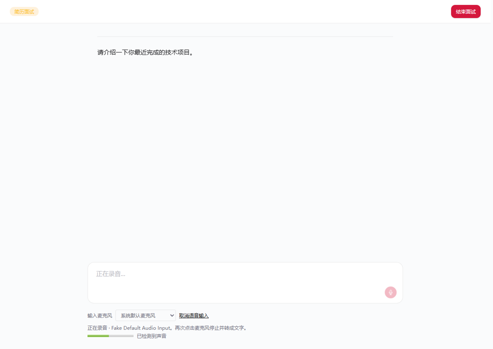

# Issue #95：模拟面试语音输入验收

## 行为与修复

模拟面试的麦克风用于录音后转成文字：点击开始，再次点击停止，识别结果追加到回答框。它不播放录音或朗读面试官的问题。

- 录音会话统一管理权限请求、录音器、音频轨道、音量检测和转写请求。
- 设备断开、录音器意外停止或报错后释放资源，显示可重试的提示。
- 取消、离开页面、结束面试或切换题目后，不启动迟到的录音，也不回填迟到的转写。
- 转写超过 60 秒会取消请求并恢复可重试状态；保留全局鉴权和额度错误处理。
- 提供输入设备选择、实际采集设备名称和音量反馈，帮助区分权限允许与实际有声音。
- 安静的 Opus 录音可能小于 1000 字节，结合实际录音时长判断过短输入；不把音量阈值当成人声识别结果。
- 编码格式与上传扩展名保持一致，超过社区版短语音 7 MiB 上限时给出提示。

## 自动验收

```sh
bun test ./frontend/tests/voice-input.test.tsx
bun run check
bun run smoke:voice
```

回归测试覆盖正常转写、权限拒绝、设备缺失、设备占用、延迟授权、重复点击、启动失败、设备结束、自然停止、录音器错误、录音大小、编码兼容、空结果、HTTP/网络错误、超时、取消、页面卸载、音量显示及设备选择。

`smoke:voice` 使用真实 Electron/Chromium、仓库的权限处理和实际 Interview 页面，注入 16 kHz 合成 WAV；ASR 使用本地模拟接口，不采集物理麦克风、不调用付费服务。

Windows x64 本地验收环境：Electron 43.4.1 / Chromium 150.0.7871.224。

| 输入/故障 | 验证结果 |
| --- | --- |
| 有声输入，简历面试与专项训练 | 音量变化、WebM 上传、文字回填、轨道释放 |
| 静音输入，简历面试与专项训练 | 显示无声音、允许低字节数的有效录音上传、空转写提示、不回填文字 |
| HTTP 500、空转写 | 显示错误，同一页面重新录音后成功 |
| 真实 Chromium 音频轨道停止 | 退出录音状态，显示中断提示 |
| 转写中取消 | 恢复可操作状态，迟到结果不回填 |

截图及上传字节记录输出至 `dist/voice-input-smoke/`。CI 的 `voice-input-windows` 任务重复运行该验收并保存产物。



## 发布后实机确认

上述测试证明代码和合成音频链路正常；它不替代原反馈用户的物理麦克风、蓝牙驱动和官方云端 ASR 验收。官方安装包还需要同步相应前端修复。

1. 在受影响的 Windows 电脑上打开包含修复的客户端，选择实际麦克风。
2. 说话时确认设备名称及音量变化；无变化时检查输入音量、静音开关和设备连接。
3. 录制一句话，停止后确认文字回填；分别验证简历面试和专项训练。
4. 录音中拔掉设备，确认出现提示；重新接入后可再次录音。
5. 验证切换题目、取消和离开页面后麦克风释放，旧转写不会进入新回答。
6. 若仍失败，记录客户端版本、所选设备、可见错误和 `/api/transcribe` 的状态码，对照服务端请求日志定位。

在原用户的物理设备和官方服务尚未确认前，PR 使用 `Related to #95`，不自动关闭原反馈。
